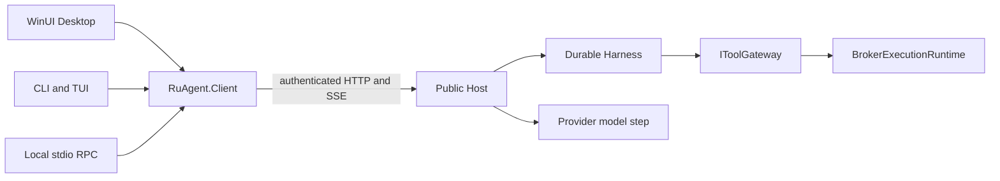

# Ru current architecture

The coding product consists of native Windows Desktop, terminal CLI/TUI, a loopback Public Host and one in-process Broker execution authority. Component implementation details live in the references below; [CONTEXT.md](../CONTEXT.md) defines domain language.

## Process topology

Desktop and CLI start or attach through `RuAgent.Client`. The shared Host owns orchestration, model generation and durable state; it composes the Broker library in process. Default startup binds an ephemeral loopback HTTP port and publishes the actual URL in the authenticated runtime descriptor after readiness. Explicit loopback bind configuration remains supported. Profile identity, rather than an assumed port, owns startup serialization.

## Ownership

| Owner | Responsibility |
| --- | --- |
| [Host](architecture/host.md) | Authentication, HTTP/SSE, profile discovery, orchestration, settings and conversation APIs. |
| [Harness](architecture/harness.md) | Run state, encrypted durable evidence, model context, recovery, subagent orchestration and schema evolution. |
| [Broker](architecture/broker.md) | Canonical argument/path validation, trust/policy enforcement, exact approvals and bounded file/terminal/network execution. |
| [GUI](architecture/gui.md) | Session presentation, drafts, transcript, approvals and side surfaces; no direct execution authority. |
| [TUI](architecture/tui.md) | Terminal presentation and shared HTTP/SSE consumption; RPC/headless behavior remains independent. |
| [Providers](architecture/providers.md) | Pinned model selection, credential-scoped catalogs, native request projection and bounded generation. |

## Coding core and plugins

The default product is .NET 10. Media surfaces and the private Runtime Worker are retired. Repository Python is tooling; optional workflow requirements produce a named failure when unavailable. The opt-in programmatic coding profile uses a bounded managed JavaScript interpreter inside Broker ([ADR 0028](adr/0028-bounded-programmatic-coding-tools.md)), without a second execution authority. See [Host implementation](architecture/host.md#coding-core-and-plugins), [runtime boundary](operations/python-runtime-boundary.md) and [ADR 0012](adr/0012-in-process-model-runner.md).

## Contracts and transport

The [canonical public route contract](../backend-dotnet/public-route-contract.json) declares the authenticated loopback HTTP/SSE surface. There is no WebSocket or second chat transport. The stdio bridge wraps those same APIs without adding an HTTP route. Protocol owns tool schemas, wire DTOs and activity enums; GUI/Client do not depend on Harness server-domain types.

## Agent autonomy and trust boundary

The [canonical policy catalog](../backend-dotnet/RuAgent.Protocol/Harness/AgentPolicyProfileContracts.cs) owns preset behavior. Permissions are session-scoped, workspace trust is explicit, and model output/workspace instructions never grant authority. `full_access` permits structured protected paths as ordinary targets; hard-invalid requests and explicit deny/ask rules still apply. Terminal launch permission does not confine Windows child processes to a filesystem or network sandbox. Exact policy and approval reasons belong in [tool policy](operations/agent-tools.md) and [Broker implementation](architecture/broker.md).

## Agent prompt contract

See [context management](architecture/context-management.md) for structured
checkpoints, guarded usage estimates and nested workspace instruction baselines.

Provider, model, protocol and tool identities remain pinned for a run. Bounded same-selection recovery never substitutes another provider. A new run can capture historical Session Run Handoff evidence; historical proposals are never replayed as executable calls and approvals do not transfer. See [Harness context](architecture/harness.md#agent-prompt-contract) and [provider selection](architecture/providers.md#run-provider-selection).

## Harness ownership

The Host orchestrates; Harness state machines own ordering/durability; Broker owns side effects. Required security collaborators fail composition when absent rather than skipping trust, policy or reconciliation. Resource services own separate run, approval, policy, workspace, activity, command and input operations. See [Harness implementation](architecture/harness.md#harness-ownership).

## Data ownership

The canonical profile keeps the shared SQLite WAL store and encrypted payloads; credentials remain in Windows Credential Manager. Schema initialization uses an ordered catalog and one atomic selected upgrade batch ending in v30 (relational conversation history and search). The released v18 schema is the supported floor; earlier versions are rejected without mutation. Development v19-v29 sources still upgrade through the catalog. Fresh and upgraded shape, rollback and concurrent initialization are checked against frozen original DDL. See [Harness persistence](architecture/harness.md#data-ownership), [ADR 0013](adr/0013-consolidate-business-persistence-in-sqlite.md) and [data location](adr/0004-canonical-ru-data-location.md).

## Privacy boundary

Credentials, bearer tokens, private provider continuation and hidden reasoning do not enter public history or diagnostics. Logs use bounded structured metadata; cancellation and lifecycle failures remain observable. User data is outside installation roots, and deletion requires an explicit successful application result. See [Broker privacy](architecture/broker.md#privacy-boundary) and [logging](operations/logging.md).

## Verification

Run commands and evidence scope are maintained in [current verification](operations/verification.md). Deterministic tests, exact-package smoke, native GUI acceptance and real-provider results are separate evidence. [Distribution and updates](operations/distribution-and-updates.md) owns packaging and release operations.
