# Ru Local Screen Awareness — Design

> Status: approved by the user on 2026-08-01. This document is the
> implementation source of truth; no screen-awareness code or model download
> has been approved merely by committing this design.

## Goal

Give Ru an explicitly enabled mode that continuously observes the Windows
primary monitor, recognizes noteworthy visual events, and proactively makes
short, playful spoken comments while the user plays a game or watches a video.
The first milestone proves local vision and a median reaction latency of at
most 2.5 seconds. System-audio understanding is a separate later milestone.

Ru remains a social conversation companion embodied by the current Live2D
avatar. Screen awareness must not turn Ru into a coding assistant, debugger,
general desktop agent, or automatic computer controller.

## Approved product decisions

- Observe only the Windows primary monitor, never a selected application or a
  secondary monitor.
- Observation starts only after an explicit user action and has an always
  visible state indicator. It is off on every app start.
- Capture is continuous from the user's perspective. The runtime samples
  representative frames automatically; the user does not take screenshots.
- Captured pixels and frames stay local. They are held only in a bounded RAM
  ring buffer and are never written to disk.
- The local vision model may return unfiltered text, names, messages, or other
  screen content. Its textual observation may be sent to the selected free
  cloud model. There is no sensitive-content detector, redactor, automatic
  pause, or cover-face action in this milestone.
- A cloud model produces every final reaction dynamically. There is no bank of
  canned reactions.
- Every screen-aware reaction must use the currently selected Ru OmniVoice
  profile. No alternative TTS voice or text-only screen reaction is allowed.
- Ru may speak over game or video sound. The first milestone does not capture,
  transcribe, analyze, or duck system audio.
- The target active cadence is about three to six comments per minute when the
  screen contains enough distinct events. Static or repetitive scenes reduce
  the cadence automatically.
- OpenCode Zen and Kilo Gateway remain the first cloud routes. Local Llama is a
  chat fallback, not the primary screen-reaction writer.

## Non-goals

- System-audio capture or understanding.
- Microphone changes or speech barge-in.
- Saving recordings, screenshots, OCR history, or a replay timeline.
- Sending raw images to OpenCode, Kilo, or another hosted provider.
- Input automation, mouse/keyboard control, gameplay assistance, debugging,
  error diagnosis, or coding advice based on the screen.
- Multi-monitor observation, window selection, or a persistent screen preview.
- Training or fine-tuning a vision model.
- Guaranteeing a 2–3 second tail latency while using a free cloud provider;
  the prototype measures that provider delay separately.

## Model strategy

The primary candidate is
[Qwen3-VL-2B-Instruct](https://huggingface.co/Qwen/Qwen3-VL-2B-Instruct),
served locally through the repository's existing llama.cpp toolchain. The
candidate is small enough to test on the RTX 4050 Laptop GPU with 6 GiB VRAM,
supports image, multi-image, video, and GUI understanding, and the checked-out
llama.cpp runtime includes Qwen3-VL multimodal support. llama.cpp's multimodal
contract uses an image-capable model plus its multimodal projector; see the
[upstream multimodal documentation](https://github.com/ggml-org/llama.cpp/blob/master/docs/multimodal.md).

The model is a candidate, not an adopted dependency, until a local benchmark
proves latency, useful event descriptions, and coexistence with OmniVoice.
SmolVLM2-2.2B is the video-oriented comparison candidate. Moondream2 is a
speed baseline if Qwen3-VL misses the latency target. MiniCPM-V/MiniCPM-o 4.5
are excluded from the first trial because their weight and runtime footprint
are not a practical initial fit for this 6 GiB GPU.

The implementation plan must pin the exact GGUF and multimodal-projector files,
their source repository, license, hashes, size, and download command before any
model is fetched. Model files and benchmark outputs stay untracked.

## Architecture

```mermaid
flowchart LR
    Capture["Rust DXGI primary-monitor capture"] --> Buffer["Bounded RAM ring buffer"]
    Buffer --> Gate["Local visual event gate"]
    Gate -->|"representative frame batch"| VLM["Qwen3-VL llama-server"]
    VLM --> Observation["structured observation"]
    Observation --> Coordinator["FastAPI reaction coordinator"]
    Coordinator --> Cloud["selected OpenCode or Kilo model"]
    Cloud --> Policy["staleness and speech policy"]
    Policy --> Voice["current Ru OmniVoice"]
    Voice --> Output["audio plus existing VTS lifecycle"]
```



The Tauri/Rust host remains the root runtime owner. It captures the screen in
process through DXGI Desktop Duplication, starts and monitors the dedicated
vision llama-server, and sends structured observations to an authenticated
FastAPI endpoint on the existing per-run loopback backend. It does not send
captured frames through the React frontend.

FastAPI owns the reaction policy and reuses the current cloud personality,
streaming, OmniVoice, and VTube Studio boundaries. The frontend receives
observation state and completed proactive-reaction events through the
authenticated runtime channel; it never receives the captured frame payload.

All child processes remain in the Tauri-created Windows Job Object. A child
must not use a breakaway flag, detached shell, PowerShell wrapper, or external
FFmpeg capture process.

## Capture and RAM retention

DXGI captures the primary monitor continuously. A lightweight sampler derives
small luma/downscaled frames for change detection and selects about two frames
per second for the observation path. It does not retain every 30–60 FPS source
frame.

The ring buffer holds only the representative frames needed to describe the
last five to ten seconds. Its capacity is fixed; inserting a new frame
overwrites the oldest allocation. Stopping observation, changing the primary
monitor, closing the app, or encountering a capture error clears the buffer
and releases all duplication textures and handles.

Only the selected frame batch is encoded in memory for the local llama-server.
No temporary path, screenshot file, video file, crash attachment, or content
log may contain frame bytes. OS-managed pagefile and process memory behavior
are outside the app-level no-disk guarantee.

## Event analysis

The event gate avoids calling the VLM for obviously unchanged frames. A simple
whole-screen pixel-difference threshold is insufficient for games, where
background motion is constant; the gate combines downscaled visual change,
scene-transition signals, recent VLM observations, and a maximum analysis
interval.

For an active scene, the VLM receives two to four chronologically ordered
frames covering a short interval. Multiple frames let it distinguish a result
or transition from a single ambiguous pose. A static scene backs off to a
slower cadence. A major scene transition may request immediate analysis.

The VLM returns strict JSON rather than Ru dialogue. The exact schema may be
extended during implementation but must include equivalent fields:

```json
{
  "scene": "multiplayer shooter match",
  "event": "the player missed several close-range shots and was eliminated",
  "confidence": 0.86,
  "novelty": 0.91,
  "comment_worthiness": 0.82,
  "visible_text": ["DEFEAT"]
}
```

Malformed JSON is rejected or repaired once locally. It never falls through as
a raw spoken reaction. Exact on-screen text is allowed in this structure and
may be passed to the cloud without privacy filtering, as explicitly approved.

## Reaction policy

The coordinator maintains only bounded in-memory observation state. It scores
confidence, novelty, comment-worthiness, repetition, the last spoken event,
and how recently Ru spoke.

- A distinct high-value event may start a reaction immediately.
- Routine events obey an adaptive cooldown targeting three to six spoken
  comments per active minute rather than a fixed timer.
- Similar consecutive events are suppressed so Ru does not repeat the same
  joke or observation.
- Only one generated reaction may be pending. A newer, more important event
  cancels a stale pending cloud request.
- Ru never starts a second utterance while its current utterance is playing.
- A reaction is discarded when the source observation has been superseded or
  its end-to-end age exceeds the configured staleness deadline.
- The cloud prompt requests one short, natural, context-aware line in Ru's
  approved `anh`/`em` voice. It forbids technical assistance, code review,
  gameplay instructions, AI-meta wording, canned phrasing, emoji, and ASCII
  emoticons. Existing private VTS and pace metadata rules remain authoritative.

The selected cloud model receives the structured observation and a small
bounded window of recent spoken reactions. Screen observations are ephemeral:
they are not inserted into chat session history, structured memory,
self-learning data, or approved examples.

## Voice and VTube Studio contract

Starting observation preflights the current Ru OmniVoice profile. If that
voice cannot warm up, observation does not enter the active state. A generated
screen reaction is discarded on voice failure; it is not spoken by another
engine and is not exposed as a text-only substitute.

The existing sentence queue, pacing metadata stripping, `VoiceVolume`
lip-sync, speaking state, and model-directed VTS actions remain in use. A VTube
Studio failure does not block OmniVoice audio. Screen awareness introduces no
new mouth parameter and does not expose private VTS markers to display,
history, memory, or TTS.

The first benchmark must measure whether Qwen3-VL and OmniVoice can coexist in
the available VRAM. GPU inference leases serialize vision and synthesis. If
co-residency causes OOM or misses latency, the trial must compare a smaller
vision quantization/model and partial CPU offload before considering repeated
vision unload/reload, because model reloads are likely to violate the reaction
target.

## Cloud and local fallback

The first implementation uses whichever configured OpenCode or Kilo cloud
backend is active. Provider-specific multimodal support is irrelevant because
the provider receives only the local VLM's textual JSON observation.

Free providers can queue, throttle, or fail, so their time is measured
separately. A timed-out or stale completion is discarded. There are no canned
fallback reactions.

If every cloud route is unavailable, observation enters `paused`: capture
stops, the vision server releases the GPU, and the existing local Llama chat
fallback may start. The 8B text model and vision model are not intentionally
kept on the 6 GiB GPU together. Screen-aware reactions are unavailable while
the local text fallback owns the GPU.

## UI states

Observation is controlled by one explicit toggle in the existing Tauri UI.
The indicator remains visible anywhere the user can leave observation active.

| State | User-facing meaning | Runtime behavior |
|---|---|---|
| `off` | Ru is not observing | No capture or vision server |
| `starting` | Ru is opening her eyes | Warm voice, load VLM, verify capture |
| `observing` | Ru is watching the primary monitor | Capture and event analysis active |
| `paused` | Observation is temporarily unavailable | Capture stopped during fallback/transition |
| `error` | Observation failed with a short reason | Chat remains available when possible |

Observation never auto-enables on launch. Closing the window exits the app; it
does not silently minimize to the system tray. A display-topology change clears
the buffer and restarts capture only if Windows still exposes a primary
monitor. A persistent screen preview is excluded; a developer-only diagnostic
preview may be designed separately if implementation evidence requires it.

## Process and failure lifecycle

- Enforce one Tauri app instance. A second launch focuses the existing window
  instead of starting another backend/model tree.
- Start the vision server only while observation is starting or active.
- Bound startup time, health checks, stderr capture, automatic restart count,
  and restart backoff. Never create an unbounded restart loop.
- Capture failure stops capture and clears the buffer; ordinary chat and voice
  remain usable.
- Vision startup/inference failure sets an honest error state. Ru must not
  claim to see the screen.
- Cloud timeout discards the reaction and keeps observation alive.
- OmniVoice failure discards the reaction and changes the observation state to
  an actionable error until the required voice is healthy.
- VTube Studio failure removes animation only; audio may continue.
- Shutdown order is: stop accepting frames, cancel analysis/cloud work, clear
  the ring buffer, release DXGI resources, stop vision gracefully, stop other
  owned services, then close the Job Object to kill any remaining descendants.
- If Tauri crashes, `JOB_OBJECT_LIMIT_KILL_ON_JOB_CLOSE` remains the final
  process cleanup boundary.

Logs may contain timestamps, state transitions, latency numbers, bounded error
messages, and process exit codes. They must not contain captured pixels, image
encodings, VLM observations, visible text, cloud prompts, or generated screen
reactions.

## Latency budget and measurement

The user-visible metric starts at the end of the source frame interval that
contains the event and ends when OmniVoice emits the first audible sample.
Instrumentation records at least:

1. capture-to-event-gate time;
2. frame preparation time;
3. local VLM queue and inference time;
4. cloud queue and generation time;
5. OmniVoice warm/synthesis-to-first-audio time;
6. total event-to-first-audio time.

The prototype target is median total latency at or below 2.5 seconds on the
current RTX 4050 Laptop GPU. Report p50, p95, and worst observed time; do not
claim that free cloud service can guarantee the target. Reactions older than
the configured staleness deadline must be discarded rather than spoken late.

## Verification and acceptance gates

The feature is not complete until all of these gates pass:

1. **Model trial:** representative game, YouTube, subtitle, static-desktop, and
   scene-transition frame groups produce useful structured observations.
2. **Latency:** the measured p50 event-to-first-audio time is at most 2.5
   seconds; p95 and cloud outliers are reported honestly.
3. **Voice:** every emitted screen reaction is spoken by the current Ru
   OmniVoice and drives the existing `VoiceVolume` lifecycle.
4. **Local pixels:** a network inspection and test doubles prove that image
   payloads go only to the loopback vision server and no frame file is created.
5. **Cadence:** an active ten-minute trial averages within the approved three
   to six comments per minute without repetitive bursts; static scenes back
   off.
6. **Staleness:** superseded and timed-out reactions never play.
7. **Resource stability:** twenty observation on/off cycles do not show
   monotonic RAM, VRAM, handle, or process growth.
8. **Lifecycle:** ten complete app open/close cycles leave no owned process;
   forced parent termination also leaves no descendant because of the Job
   Object.
9. **Single instance:** a second launch cannot create another backend, vision,
   or voice server.
10. **Fallback:** cloud loss pauses observation, releases vision resources, and
    allows the existing local chat fallback without simultaneous 8B text/VLM
    GPU residency.
11. **Failure truthfulness:** unavailable capture, VLM, cloud, voice, and VTS
    paths expose their actual degraded state and never fabricate observation.

## Deferred system-audio milestone

After local vision passes its own quality, latency, and lifecycle gates, a new
design may add WASAPI loopback capture, local speech/event understanding, audio
and visual timestamp alignment, echo handling for Ru's own OmniVoice output,
and rules for reacting to dialogue versus sound effects. No audio capture is
part of the implementation plan derived from this document.
