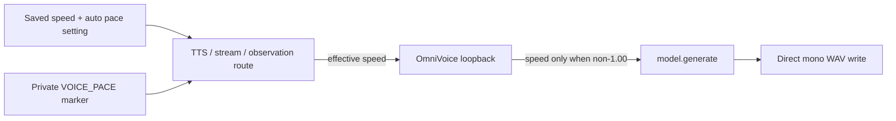

# OmniVoice artifact-free voice controls

Date: 2026-08-07
Status: implemented in code; automated and loopback verification recorded; human listening acceptance for native non-1.00x speed remains pending
Scope: remove the rejected local DSP voice transformations, make automatic
pacing respect its saved setting, and use OmniVoice's native speed control for
the remaining explicit speed feature.

## Decision

The quality baseline is Ru or Ái Vy clone audio at 1.00x with no
post-generation waveform processing. The application must no longer invoke
`librosa.effects.pitch_shift` or `librosa.effects.time_stretch` anywhere in
the OmniVoice synthesis path.

`voice_style_id` remains as a small backwards-compatible transport field, but
`original` becomes its only supported value. Historical `low_pitch`,
`high_pitch`, and `whisper` values resolve safely to `original` when loaded.
Fresh API and loopback requests for any retired value are rejected. The WinUI
voice-style selector is removed rather than leaving an inactive choice visible.

Manual base speed remains 0.75x–1.20x. When an effective speed differs from
1.00x, `synthesize_fast` passes it to OmniVoice's native
`model.generate(..., speed=...)` argument. At exactly 1.00x it omits the
argument to preserve the current clone-only baseline unchanged. It writes the
model's mono waveform directly to WAV.

Automatic pace remains opt-in. The default becomes off for new settings and
the WinUI toggle starts off. When enabled, the existing bounded slow/normal/
quick calculation supplies the native model speed. When disabled, the TTS,
WebSocket stream, and screen-observation routes send the saved manual speed
unchanged. Existing persisted `true` values remain an explicit user choice.

## Data flow

No voice-style or pace metadata enters visible chat text, TTS text, history,
memory, prompts, or VTube metadata.

## Acceptance criteria

- `voice_style_by_id` accepts only `original`; all retired historical values
  resolve to `original` through `voice_style_from_saved`.
- Fresh settings and loopback requests reject `low_pitch`, `high_pitch`, and
  `whisper`.
- Synthesis with 1.00x omits `speed` from `model.generate`; synthesis with
  1.08x sends `speed=1.08`, with no local speed or pitch processor present.
- Saved `auto_pace_enabled=false` sends 1.00x for a `quick` marker in TTS,
  streaming, and observation paths. Saved `true` sends the bounded 1.08x
  value.
- Backend and WinUI defaults for automatic pacing are false; the cloud-memory
  default remains true.
- The Voice view exposes no pitch/style selector and still saves a stable
  `original` style ID for compatibility.
- Python tests, WinUI tests, Release GUI build, and a sequential live Ru
  loopback check pass. Human listening remains the final quality gate for
  native non-1.00x speed.

## Constraints and non-goals

- Do not download or add a model, a third-party DSP library, or a new service.
- Do not change voice reference assets, clone prompts, OmniVoice profile
  tuning, VTube behavior, chat persona, or `share_memory_with_cloud=true`.
- Do not claim that native speed improves quality until the user listens to
  original, slow, and quick Ru samples.
