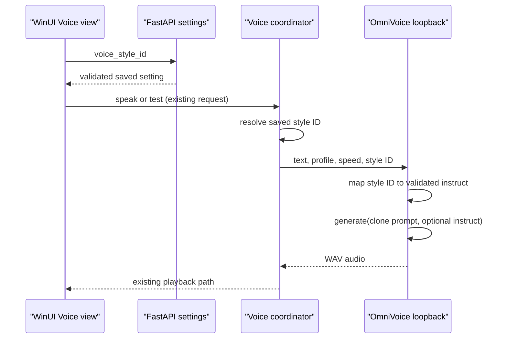

# OmniVoice voice-style presets design

Date: 2026-08-07
Status: Implemented; live Vietnamese listening acceptance pending OmniVoice reload
Scope: controlled OmniVoice `instruct` adjustments for the WinUI 3 Voice view

## Decision

Expose a small set of validated voice-style presets for the existing Ru and Ái
Vy OmniVoice clone profiles. The default is **Giữ giọng gốc** and sends no
`instruct` argument to OmniVoice, preserving the current quality and latency
path exactly.

The feature deliberately does not expose arbitrary prompt text. OmniVoice
accepts a constrained set of style attributes and its voice-design behaviour
is less stable than its clone mode, especially for Vietnamese. A preset keeps
the behaviour understandable, testable, and reversible.

## Goals

- Let the user make a subtle, intentional adjustment to a cloned voice.
- Keep the reference audio and cached clone prompt as the primary voice
  identity for both supported profiles.
- Preserve the native 1.00x default path, selected generation configuration,
  single-GPU lifecycle, cloud-memory default, and existing voice pacing.
- Keep voice-style metadata out of visible chat, spoken text, conversation
  history, structured memory, self-learning input, VTube metadata, and logs
  that contain user content.
- Make an unsupported saved value safe: migrate it to the default rather than
  breaking speech.

## Non-goals

- A free-form natural-language style prompt or an LLM-generated voice prompt.
- Changing the identity, gender, age, or accent of either clone profile.
- Replacing OmniVoice, changing its selected `vi-normalized-16` configuration,
  or changing speech speed/pacing.
- Changing `share_memory_with_cloud`, which remains enabled by default.
- Claiming a quality improvement without a Vietnamese listening check.

## Preset contract

The persisted setting is `voice_style_id`. It has stable, UI-independent
values:

| ID | UI label | OmniVoice instruction |
| --- | --- | --- |
| `original` | Giữ giọng gốc | omitted |
| `low_pitch` | Trầm hơn | `low pitch` |
| `high_pitch` | Cao hơn | `high pitch` |
| `whisper` | Thì thầm | `whisper` |

The mapping is kept in a small shared Python module. The GUI exchanges only
the stable ID with the FastAPI settings endpoint. The loopback OmniVoice server
resolves the ID to its `instruct` string immediately before
`model.generate(...)`, alongside the cached `voice_clone_prompt`.

No prompt text entered by a user is accepted or persisted. The selected style
ID is normal application settings data, not response content or a voice-control
marker.

## Architecture and data flow

### Backend

Add `voice_style_id: VoiceStyleId` to `_DEFAULT_SETTINGS`, defaulting to
`original`, and normalize legacy, malformed, or absent saved values to that
default in both settings-read paths. The settings API accepts only the four
known IDs; an invalid new request receives normal validation failure rather
than being saved.

`/voice/tts` and `/voice/stream` resolve the style once at request start. The
request-scoped `VoiceStreamCoordinator` carries the ID together with profile
and speed through `_server_shared.request_voice_audio`. Its loopback JSON
payload adds `voice_style_id`; it never adds style markup to `text`.

The loopback server accepts only a known ID. It calls
`model.generate(text=..., voice_clone_prompt=..., instruct=...)` only when the
resolved instruction is non-empty. `original` must leave `instruct` absent so
the existing model call and latency baseline stay identical.

### WinUI 3

Place a ComboBox labelled **Điều chỉnh giọng** directly below **Chọn giọng
đọc**. It contains the four labels above and uses the stable ID as its tag.
Loading settings selects the matching item; unknown or missing values select
**Giữ giọng gốc**. Changing it saves through the same voice-settings request
as profile, base speed, pacing, and auto-read.

The test, auto-read, stream, and complete-WAV fallback paths remain unchanged
at the UI boundary. They read the saved setting in the backend, avoiding a
second, divergent GUI playback state.

## Failure handling and privacy

- A corrupt historical setting falls back to `original` on read.
- A malformed client update is rejected before persistence.
- A malformed loopback style ID causes a local synthesis error; it must not be
  passed to OmniVoice as arbitrary text.
- The selected style must not be appended to the assistant reply, generated
  text, voice markers, history, memory, VTube actions, or benchmark text.
- No new process, model download, warm-up, or GPU residency is introduced.

## Verification

Automated coverage proves:

- mapping and validation of every supported ID;
- default and legacy values resolve to `original`;
- `/settings`, `/voice/status`, `/voice/tts`, and `/voice/stream` carry the
  setting correctly;
- the default TTS call omits `instruct`, while each non-default preset sends
  the exact expected instruction with the existing clone prompt;
- unknown IDs are rejected or safely normalized at the appropriate boundary;
- GUI DTO/load/save behaviour retains the selected preset.

Observed on 2026-08-07: the full Python suite passed 428 tests with no failures
or errors; the WinUI test suite passed 48 tests; and the self-contained Release
publish completed. The active OmniVoice service was started before this feature
and had its model loaded, so it was not restarted automatically. Therefore no
new-preset WAV is treated as a listening result yet.

After an explicit OmniVoice reload, generate the same short
Vietnamese and Vietnamese-English samples for Ru and Ái Vy at 1.00x across all
four presets. Compare pronunciation, identity, artifacts, and first-audio
timing against `original`. The feature is shipped with `original` selected;
non-default presets are presented as experimental adjustments until the user
confirms the listening result.

## Documentation updates

Update the Voice section of `README.md` after implementation with the preset
names, default behaviour, privacy rule, and Vietnamese listening verification
steps. Existing documents remain current; no obsolete document is removed by
this narrowly scoped change.
