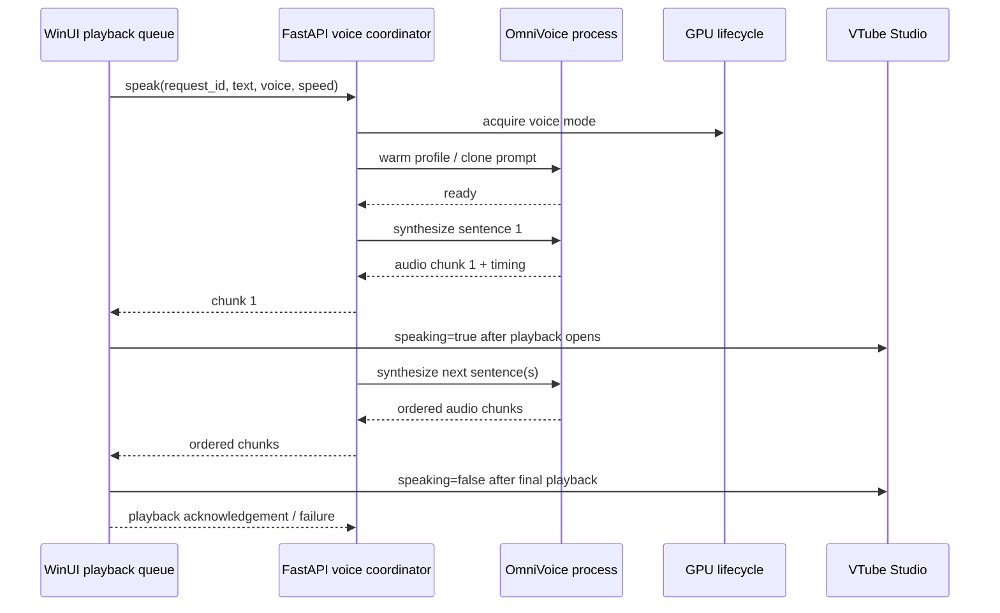

# Voice quality and latency design

Date: 2026-08-07
Status: Implemented in code; live audio/latency acceptance pending
Scope: local OmniVoice output used by the WinUI 3 GUI

## Decision

Keep OmniVoice as the active TTS engine and improve the pipeline around it. The
first implementation will optimize spoken quality and time-to-first-audio
without introducing a second model. Model replacement is explicitly deferred
until the current path has a reproducible baseline.

## Goals

- Preserve or improve Vietnamese and Vietnamese-English pronunciation,
  natural pauses, emotion, and voice identity.
- Reduce time from a completed assistant reply to the first audible audio.
- Avoid stale, duplicated, clipped, or overlapping audio when a new reply
  interrupts the previous one.
- Keep VTube Studio speaking state and `VoiceVolume` lip-sync aligned with real
  playback.
- Keep the design safe for the 6 GB GPU: only one heavyweight model is active
  at a time.

## Non-goals

- Replacing OmniVoice before measuring it properly.
- Adding cloud TTS or silently changing the selected voice.
- Making `librosa.time_stretch` the default speed mechanism.
- Persisting voice-control markers or playback metadata in chat, history, or
  memory.

## Current constraints

- `src/mini_gpt/omnivoice_tts_server.py` currently creates a complete WAV for a
  request. The existing `tts_stream` endpoint still synthesizes every chunk
  and concatenates the result before returning it.
- The compatibility path still requests one complete WAV, while the primary
  GUI auto-read path now uses authenticated `/voice/stream` sentence chunks and
  an ordered WinUI playback queue with complete-WAV fallback.
- OmniVoice has a cached model and per-profile clone prompts, but Llama and
  OmniVoice cannot be assumed to coexist within the available VRAM.
- The current GUI trial is Vietnamese-normalized OmniVoice with 16 steps. The
  baseline and 20/24-step candidates remain available for comparison.
- Speed changes use `librosa.effects.time_stretch` away from 1.00x, which can
  introduce metallic artifacts.

## Proposed architecture

### Backend voice coordinator

Add one request-scoped coordinator at the FastAPI voice seam. It owns a
monotonic `request_id`, cancellation, chunk ordering, timing fields, and the
decision to drop stale audio. The coordinator must not expose internal VTS or
voice-pacing markers to the GUI as user text.

The coordinator will prefer sentence-sized chunks. It will synthesize the
first sentence immediately and enqueue later sentences in order. The GUI keeps
generation and playback in separate bounded stages, so later audio can be
prefetched while the current sentence plays without overlapping output. A short
sentence is the minimum unit because splitting inside a sentence risks harming
prosody and voice identity.

Use a dedicated authenticated WebSocket endpoint at `/voice/stream`; do not
reuse the `/chat` socket. JSON control frames will carry `start`, `end`,
`cancel`, `failed`, and playback acknowledgement events. Binary frames will
carry ordered audio chunks with the request ID and sequence number represented
in the preceding control frame. This gives the GUI incremental delivery and a
bidirectional cancel/ack path without making it wait for a complete WAV.

### OmniVoice adapter

Keep model and clone-prompt caches inside the OmniVoice adapter. The adapter
will expose measured generation settings per profile/configuration and will
report warm-up, first-chunk, and per-chunk synthesis timings without logging
the spoken text or raw audio.

Use native 1.00x speed as the quality reference. For non-default speed,
compare native generation settings against time-stretch output; retain the
current bounded speed limits until listening tests prove a better method.

### WinUI playback queue

Replace whole-response playback with a request-scoped queue. The queue must:

- start playback when the first valid chunk opens;
- preserve chunk order and avoid gaps where the platform permits;
- cancel and dispose all pending chunks on interruption;
- ignore chunks from an older request;
- send VTS speaking state only from actual media lifecycle events;
- acknowledge started, ended, cancelled, and failed playback.

If the platform cannot guarantee gapless playback for the chosen transport,
the queue will use sentence chunks and a small bounded prebuffer rather than
playing overlapping audio.

### GPU lifecycle

Keep the existing single-GPU ownership rule. Voice mode releases local Llama
before warming OmniVoice; local generation releases OmniVoice before loading
Llama. A later optimization may keep OmniVoice warm for a short voice session,
but only after measuring VRAM and cleanup behaviour. No concurrent loading is
allowed in this phase.

## Quality evaluation

Create a fixed, versioned listening set covering:

- natural Vietnamese conversation;
- Vietnamese-English code switching;
- names, numbers, abbreviations, and punctuation;
- short replies and long multi-sentence replies;
- calm, sympathetic, playful, and excited delivery;
- interruption and resumed playback.

Run each sample for both voice profiles and each candidate configuration:
`baseline-16`, `vi-normalized-16`, `vi-normalized-20`, and
`vi-normalized-24`. Keep speed at 1.00x for the primary comparison. Record
blind human ratings for pronunciation, naturalness, prosody, artifacts, and
voice identity, plus machine timings.

The selected configuration must be non-inferior to the current voice in
pronunciation and naturalness. A faster configuration is not accepted if it
introduces audible clipping, metallic artifacts, broken pauses, or degraded
Vietnamese-English pronunciation.

## Latency and reliability evaluation

Record these timestamps per request without storing the spoken content:

- request accepted;
- GPU mode acquired;
- voice service ready;
- first chunk generated;
- first chunk opened by the GUI;
- first audio actually started;
- final chunk ended;
- playback acknowledgement received.

Report cold and warm p50/p95 values separately. The first optimization gate is
that warm time-to-first-audio improves materially without degrading the blind
quality score. The second gate is that cold-start behaviour remains bounded
and all cancellation paths release GPU, media, and VTS state.

## Failure handling

- If warm-up or synthesis fails, return a clear unavailable result and never
  switch the saved voice silently.
- If a newer request arrives, cancel the old request and discard its future
  chunks.
- If GUI playback fails, send a failure acknowledgement and reset VTS
  speaking state.
- If the voice process exits, surface the existing local-service error and
  allow the next request to restart it.
- Never put request IDs, pace markers, timing metadata, or errors into visible
  chat, TTS input, history, memory, or training data.

## Implementation phases

1. **Baseline:** add timing and audio-output records; run the fixed listening
   set with the existing complete-WAV path.
2. **Quality selection:** compare the four OmniVoice configurations and both
   profiles at native 1.00x; select a configuration per profile.
3. **Incremental playback:** implement ordered sentence chunks, cancellation,
   and GUI queue playback. Hosted replies now begin at completed sentence
   boundaries and prefetch later audio while the current chunk plays; local
   Llama retains the single-GPU lock. Live audio acceptance remains pending.
4. **Lifecycle hardening:** add playback acknowledgements, stale-chunk tests,
   VTS reset behavior, and GPU cleanup checks. Done in code; repeated live
   device/process-cycle acceptance remains pending.
5. **Acceptance:** run real microphone/TTS/VTube smoke tests and compare cold
   and warm latency against the baseline before enabling the new path by
   default.

## Acceptance criteria

- Blind listening shows no regression in pronunciation, naturalness, or voice
  identity for either supported profile.
- Warm time-to-first-audio is lower than the current complete-WAV path.
- No stale or duplicate audio is heard across interruption tests.
- VTube speaking state follows actual playback start/end/failure.
- Repeated warm/cancel/release cycles leave no owned voice process, media
  player, or GPU allocation behind.
- Existing voice settings, private metadata rules, chat generation, and local
  Llama lifecycle remain intact.
